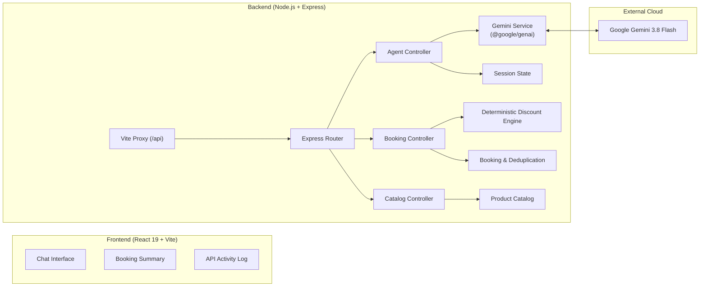

# 🌟 AI Sales Agent — Full-Stack Technical Challenge

A clean, modular full-stack application built for a technical interview challenge demonstrating an **AI Sales Agent** with consultative solution selling, catalog integration, deterministic discount enforcement, duplicate booking prevention, and real-time API telemetry.

---

## 📌 Project Overview

The **AI Sales Agent** is an enterprise-grade conversational sales platform that combines an **LLM-driven consultative chatbot** with a **deterministic backend business rules engine**.

### Core Philosophy: Strict Separation of Concerns
- **Google Gemini LLM (`gemini-3.8-flash`)**: Understands customer needs in natural language, answers product questions, handles consultative selling, and conducts the conversation flow.
- **Node.js + Express Backend**: Authoritatively controls product inventory, calculates exact capacity-based quantities, enforces deterministic discounts, and manages bookings. The LLM is **never** permitted to calculate prices, fabricate discounts, or book orders autonomously.

---

## 🏗️ Architecture & Data Flow



---

## 🏛️ Core Capabilities & Pillars

| Pillar | Description | Implementation File |
| :--- | :--- | :--- |
| **Consultative AI Chat** | Interacts with users in real-time using Google's `gemini-3.8-flash` model via the official `@google/genai` SDK. | [`backend/src/services/geminiService.js`](backend/src/services/geminiService.js) |
| **Deterministic Discounts** | Computes mathematical subtotal, discount percentages, and final prices server-side. Enforces rules so discounts cannot be manipulated. | [`backend/src/services/discountService.js`](backend/src/services/discountService.js) |
| **Session Management** | Tracks in-memory conversation history, user preferences, and active quotation drafts across multiple chat turns. | [`backend/src/services/sessionService.js`](backend/src/services/sessionService.js) |
| **Duplicate-Proof Booking** | Generates human-friendly IDs (`BK-XXXX-XXXX`), validates customer email/name, and blocks duplicate submissions using idempotency tokens. | [`backend/src/services/bookingService.js`](backend/src/services/bookingService.js) |
| **Live API Telemetry** | Intercepts all `GET` and `POST` network requests and visualizes HTTP status codes, execution times, and JSON payloads in a real-time developer drawer. | [`frontend/src/components/ApiActivityLog.jsx`](frontend/src/components/ApiActivityLog.jsx) |

---

## 🛠️ Technology Stack

- **Backend**: Node.js, Express.js (ES Modules, pure JavaScript)
- **Frontend**: React 19 + Vite (pure JavaScript/JSX, Vanilla CSS design system)
- **LLM Integration**: Google Gemini API via official `@google/genai` SDK
- **Icons & UI**: Lucide React, Inter typography, custom dark glassmorphism layout
- **Architecture**: Separated `backend` and `frontend` with Vite dev proxy to prevent CORS issues and strictly prevent exposing secrets/API keys to the client.

---

## 📂 Project Structure

```text
ai-sales-agent/
├── backend/
│   ├── .env.example              # Environment variables template
│   ├── .env                      # Local environment configuration (contains GEMINI_API_KEY)
│   ├── .gitignore                # Backend git ignore rules (ignores .env and node_modules)
│   ├── package.json              # Express, CORS, dotenv, @google/genai
│   └── src/
│       ├── server.js             # Express entry point, middleware, routes mounting
│       ├── config/
│       │   └── gemini.js         # Official @google/genai SDK client configuration
│       ├── controllers/
│       │   ├── agentController.js    # Chat consultation & session orchestration
│       │   ├── catalogController.js  # GET catalog and product lookup
│       │   └── bookingController.js  # POST booking creation & price calculation
│       ├── routes/
│       │   ├── agentRoutes.js    # Routes for /api/chat
│       │   ├── catalogRoutes.js  # Routes for /api/catalog
│       │   └── bookingRoutes.js  # Routes for /api/bookings
│       └── services/
│           ├── geminiService.js   # Gemini API caller with system prompts
│           ├── catalogService.js  # Product inventory & keyword matching stubs
│           ├── discountService.js # Deterministic volume & promo discount engine
│           ├── bookingService.js  # Booking validator & duplicate prevention
│           └── sessionService.js  # In-memory conversation & cart session store
│
├── frontend/
│   ├── index.html                # HTML entry point with Inter font & metadata
│   ├── vite.config.js            # Vite configuration with /api proxy to port 5000
│   ├── package.json              # React 19, Vite, Lucide React
│   └── src/
│       ├── main.jsx              # React app entry point
│       ├── App.jsx               # Main dashboard layout & state orchestrator
│       ├── App.css               # Dashboard and panel styles
│       ├── index.css             # Vanilla CSS design tokens, themes & resets
│       ├── components/
│       │   ├── Header.jsx           # App branding, health badge & session reset
│       │   ├── ChatInterface.jsx    # Consultation chat stream with suggestions
│       │   ├── BookingSummary.jsx   # Draft order, discount, final price & booking ID
│       │   └── ApiActivityLog.jsx   # Live GET & POST network request inspect log
│       └── services/
│           └── api.js               # Centralized fetch client with log pub/sub
│
└── README.md                     # Project documentation & run guide
```

---

## 🚀 How to Run Both Applications

### 1. Prerequisites
- **Node.js** v18+ (tested on Node v24)
- **npm** v9+
- A **Google Gemini API Key** (from [Google AI Studio](https://aistudio.google.com/))

---

### 2. Backend Setup & Startup

1. Open a terminal and navigate to the `backend` folder:
   ```bash
   cd backend
   ```

2. Dependencies are already installed (`npm install` if cloning fresh).

3. Configure your Gemini API key in `backend/.env`:
   ```env
   PORT=5000
   GEMINI_API_KEY=your_gemini_api_key_here
   GEMINI_MODEL=gemini-3.8-flash
   ```

4. Start the backend in development mode (with hot reloading via Node `--watch`):
   ```bash
   npm run dev
   ```

5. The backend starts on **`http://localhost:5000`**. Verify status at `http://localhost:5000/health`.

---

### 3. Frontend Setup & Startup

1. Open a **second terminal** and navigate to the `frontend` folder:
   ```bash
   cd frontend
   ```

2. Dependencies are already installed (`npm install` if cloning fresh).

3. Start the Vite development server:
   ```bash
   npm run dev
   ```

4. Open your browser and navigate to:
   ```
   http://localhost:5173
   ```

---

## 🔌 API Endpoints Summary

| Method | Endpoint | Description |
| :--- | :--- | :--- |
| **GET** | `/health` | Health check & Gemini key configuration status |
| **GET** | `/api/catalog` | Fetch catalog items (supports `?category=...`, `?inStock=...`, `?q=...`) |
| **GET** | `/api/catalog/:id` | Fetch single product by ID |
| **POST** | `/api/chat` | Send message to AI Sales Agent (`{ sessionId, message }`) |
| **GET** | `/api/chat/session/:id` | Retrieve active session details and chat history |
| **DELETE**| `/api/chat/session/:id` | Reset conversation session |
| **POST** | `/api/bookings/calculate`| Calculate deterministic volume & promo discounts |
| **POST** | `/api/bookings` | Create confirmed booking with duplicate prevention |
| **GET** | `/api/bookings` | List all confirmed bookings |
| **GET** | `/api/bookings/:id` | Fetch confirmed booking record by Booking ID |

---

## 🔒 Security & Best Practices

1. **No API keys in client code**: The frontend never contacts Google Gemini directly; all requests pass through Express backend endpoints via Vite dev proxy.
2. **Deterministic Discount Rules**: Pricing and discounts are computed server-side in `discountService.js` to guarantee the LLM cannot hallucinate or grant unauthorized price reductions.
3. **Duplicate Prevention**: `bookingService.js` validates customer details and blocks duplicate orders using idempotency keys and signature caching.
4. **Git Hygiene**: Sensitive `.env` files are ignored globally and locally, preventing credential leaks on public repositories.
